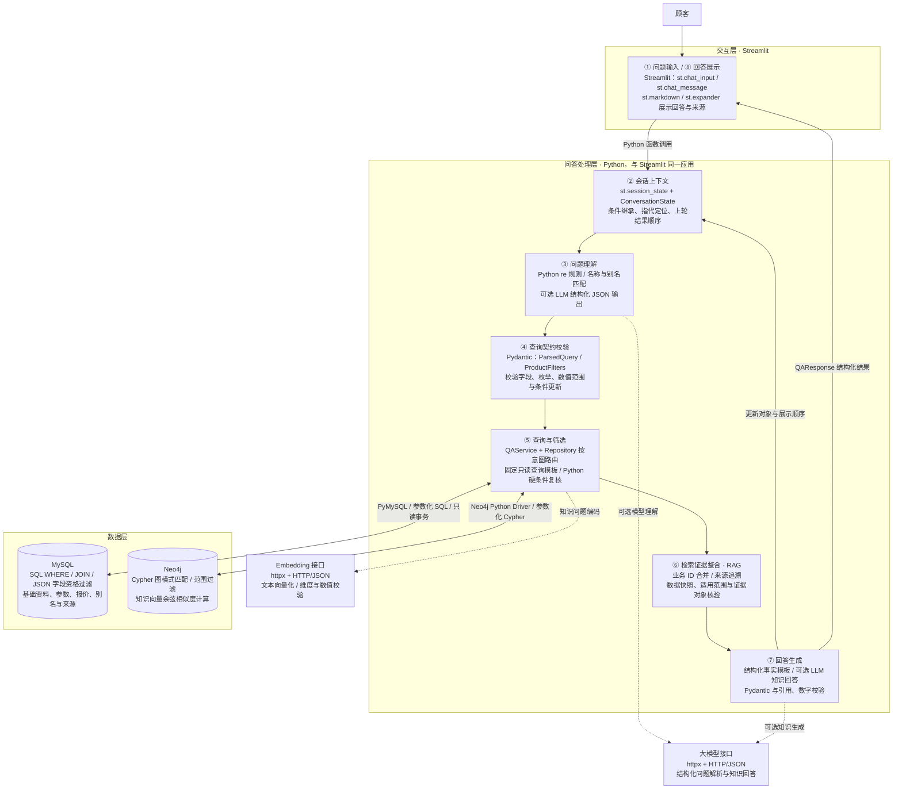
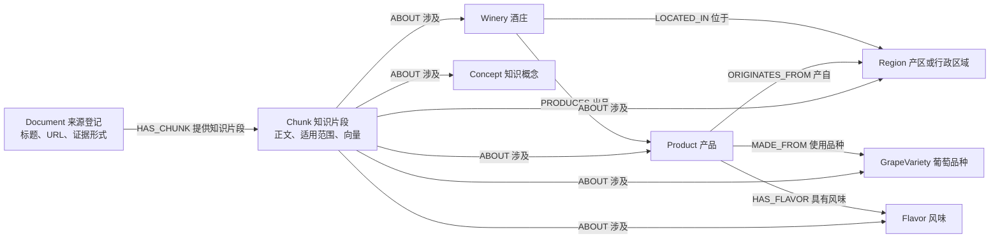

# 宁夏葡萄酒智能问答系统架构设计

对应软件版本 v0.2.0，更新于 2026-11-18。

系统面向查询宁夏酒庄、葡萄酒产品及相关知识的顾客，采用 Streamlit、Python、MySQL、Neo4j，以及独立配置的大模型和 Embedding 模型。

## 1. 系统目标与设计原则

系统以一个顾客问答窗口为入口，提供以下五项功能：

| 功能 | 目标 |
|---|---|
| 酒庄信息查询 | 查询酒庄名称、位置、所属区域、基础介绍等已收录信息 |
| 产品基本信息介绍 | 介绍具体产品的所属酒庄、年份、容量、类型、品种、酒精度等已披露参数 |
| 葡萄酒知识问答 | 根据有来源的材料回答葡萄酒概念、品鉴、储存等知识问题 |
| 产品条件筛选 | 根据类型、容量、品种等条件精确筛选；价格筛选取决于合格报价是否齐备 |
| 简单连续问答 | 支持继承或修改条件，以及“这款”“第二款”“它的酒庄”等上下文追问 |

第一版采用以下设计决策：

1. 使用 Streamlit 构建页面，Python 模块完成问答逻辑，作为一个应用运行。
2. 采用交互层、问答处理层、数据层三层逻辑结构，模块之间通过函数调用协作。
3. MySQL 与 Neo4j 共同构成数据层。它们是两个独立数据库，应用统一访问；“统一数据层”不表示两个引擎合并为一个数据库。
4. MySQL 负责运行时基础事实、精确筛选与报价查询；Neo4j 负责实体关系、知识片段及向量检索。
5. 当前会话状态保存在应用中，第一版不要求跨浏览器、跨设备恢复聊天记录。
6. 数据通过离线脚本清洗、校验、导入和更新，不建设管理员页面。
7. 模型通过明确接口调用，供应商和具体模型在后续配置阶段确定，不以微调模型作为第一版前置条件。

订单、支付、物流、会员、实时库存和评论情感分析不属于本版功能范围。若以后改用 Vue 页面，可在现有 Python 问答模块外增加 FastAPI 接口；当前 Streamlit 方案直接调用模块即可。

## 2. 系统架构图

下图按一次问答的处理顺序标注步骤和所用技术，展示 `database` 模式下的访问路径。实线表示处理流程、查询及结果返回，虚线表示按需调用模型；同一请求根据意图选择数据源，不必经过所有查询分支。



图中模块是代码职责划分，不需要拆成多个微服务。部署时由一个 Streamlit 应用进程访问 MySQL、Neo4j 和模型接口；数据库运行在本机或可访问的服务器上，连接地址通过配置指定。

各步骤的技术与代码对应如下，编号与图中保持一致：

| 步骤 | 涉及的技术 | 在本项目中的作用 |
|---|---|---|
| ① 问题输入 | Streamlit `st.chat_input`、Python 函数调用 | `app.py` 启动 `qa/router/streamlit_ui.py`，由入口将问题和会话传给 `QAService.ask()` |
| ② 会话上下文 | Streamlit `st.session_state`、Python `dataclass` | `qa/models/conversation.py` 保存消息、条件、对象及已展示的产品顺序 |
| ③ 问题理解 | 正则规则、名称与别名匹配、可选 LLM JSON 输出 | `qa/service/understand.py` 识别意图、实体、单位、条件修改和序号指代 |
| ④ 查询契约校验 | Pydantic v2、`ParsedQuery`、`ProductFilters` | `qa/schemas/query.py` 校验结构和范围，`qa/service/chat.py` 解析实体并合并或删除条件 |
| ⑤ 查询与筛选 | 参数化 SQL 和 Cypher、只读事务、余弦相似度 | `qa/repository` 查询数据库，`qa/db` 管连接和事务，`qa/models/product_rules.py` 复核产品条件 |
| ⑥ 检索证据整合 | RAG、稳定业务 ID、数据快照校验、来源登记与图关系 | `qa/service/chat.py` 联合两库结果、知识片段和来源，核对对象与快照 |
| ⑦ 回答生成 | Python 事实模板、可选 LLM、Pydantic 校验 | `qa/service/answer.py` 展示产品事实，按本轮证据生成并校验知识回答 |
| ⑧ 回答展示 | `QAResponse`、Streamlit `st.chat_message` / `st.markdown` / `st.expander` | `app.py` 展示回答、来源及必要说明，服务层保存本轮实际结果顺序，供下一轮定位 |

当前实现说明：

- 本图技术标注依据现有 `app.py`、`qa/` 和 `requirements.txt`，表示代码采用的技术，不替代在线服务就绪检查。默认 `demo` 模式读取正式 JSONL；切换到 `database` 模式后才使用图中的两库查询路径。
- 大模型和 Embedding 分别配置，由 `qa/clients/http.py` 通过 httpx 调用。问题理解与知识回答可使用大模型，结构化事实回答使用模板。
- Neo4j 知识召回先在 Cypher 中限定实体、主题、适用范围和数据快照，再通过 `vector.similarity.cosine` 计算候选片段相似度并取前几条。当前使用精确余弦排序，不将其标为 ANN 近似检索或 BM25 混合召回。
- 离线脚本 `scripts/build_embeddings.py` 负责知识文本向量化、写入 Neo4j、创建/核对命名向量索引及检查 ONLINE 状态；在线知识问答检查向量是否完整就绪。Neo4j 同时保存图关系与知识向量，本方案不另设向量数据库。
- 当前偏好只记录在会话及输出说明中，尚未实现偏好排序；合格产品按稳定业务 ID 展示。硬条件过滤已经与该待实现能力分开标注，第一版也没有独立 Reranker 模型。

模块的实现边界与运行方式详见 [后端框架说明](后端框架说明.md)。其余章节保留整体设计与规划，实际实现状态以代码和运行验收为准。

## 3. 各模块职责

| 模块 | 输入 | 核心职责 | 输出 |
|---|---|---|---|
| 问答窗口 | 顾客文本 | 展示聊天记录、产品信息、来源，提供开启新会话入口 | 当前问题与会话状态 |
| 问题理解 | 当前问题与有效上下文 | 区分查询、知识问答、筛选和追问；定位实体；抽取与更新条件 | 规范化查询任务 |
| 检索与筛选 | 查询任务 | 执行查询模板，获取知识证据，完成硬过滤与有依据的软排序 | 事实记录、候选产品、知识片段及来源 |
| 证据整合与回答 | 问题、条件、检索结果 | 合并跨库结果，组织回答，核对产品 ID、规格、数值与来源 | 回答文本、展示产品 ID、证据引用 |
| 会话状态 | 查询任务与最终展示结果 | 保存当前对象、有效条件、偏好及产品顺序 | 下一轮所需上下文 |

大模型负责理解自然语言和组织回答；Embedding 模型负责把问题与知识文本转换为可比较的向量。两者的职责和配置分别管理。

大模型输出规范化条件，由后端校验字段、枚举、单位和范围，再填入预设的只读 SQL/Cypher 模板。查询字段、排序方式和关系类型使用白名单，避免将任意模型文本直接当作查询执行。

## 4. 数据分工与关系设计

### 4.1 MySQL：基础事实与精确查询

沿用 `database/01_schema_mysql.sql` 中已有的表结构，不因简化页面而重新设计一套不兼容的数据表。

| 表或视图 | 主要作用 |
|---|---|
| `winery`、`region` | 酒庄资料及产区/行政区域信息，保留区域类别 |
| `product` | 产品、年份状态、容量、颜色、甜度、酒精度及字段筛选资格 |
| `grape_variety`、`product_grape` | 已明确披露的葡萄品种及产品关联，配比未知时保留空值 |
| `price_observation` | 某来源在某时间针对特定销售规格给出的报价观察 |
| `source_document` | 来源标题、链接、证据形式和采集信息 |
| `entity_registry`、`entity_alias` | 稳定实体 ID 及名称/别名映射 |
| `professional_review` | 与具体产品及适用年份对应的附加评价资料 |
| `v_product_basic` | 产品、酒庄及产品产区联合查询视图 |
| `v_eligible_retail_price` | 合格单瓶人民币零售价候选视图；应用仍需检查核验时效 |

主要表关系为：

- 一家酒庄对应多个产品，使用 `product.winery_id` 关联。
- 酒庄和产品分别关联区域，不能仅根据酒庄地址推定产品产区。
- 产品与品种通过 `product_grape` 建立多对多关系。
- 一个产品可以具有多条报价观察，每条报价关联具体来源。
- 别名通过 `entity_registry` 指向稳定业务实体，一个别名允许对应多个候选对象。

产品资料优先区分酒款、年份和容量。未披露年份或规格的记录保留其 `record_scope` 和 `vintage_status`，不能默认补成某个年份或 750 mL，也不能冒充具体 SKU。

### 4.2 Neo4j：实体关联与知识检索

沿用现有导入脚本的节点标签与关系类型。以下关系图描述数据模型，具体关系仅在资料有依据时建立。



`ABOUT` 统一表达知识片段涉及的实体，不另外创建“介绍”“解释”等同义关系类型。一个片段可以关联多个实体，也可能由多个来源支撑。`Document` 是来源登记，不表示项目一定保存了原网页全文或快照；采集摘要仍需保留其摘要性质。

所有节点具有 `QAEntity` 标签及统一 `entity_id`；酒庄、产品、来源和知识片段还保留 `winery_id`、`product_id`、`source_id`、`knowledge_id` 等业务字段。跨库关联使用这些稳定 ID，不使用 Neo4j 内部节点编号。

### 4.3 跨库一致性

正式清洗 JSONL 是两库共同的离线发布依据。MySQL 生成脚本与 Neo4j 导入脚本读取同一批数据，应用按业务 ID 合并结果。

现有 Neo4j 导入脚本会复制部分产品和酒庄属性。它们属于同批数据的镜像；产品参数、报价及最终筛选结论仍以 MySQL 查询结果为准，不在两边分别人工维护同一字段。

两库没有跨引擎外键或联合事务。更新时离线核对两边数据版本与引用，完成后再启用该批数据；Neo4j 查询限定项目归属和选定的 `qa_snapshot`。图谱返回但 MySQL 中不存在的产品不能直接作为可展示产品返回。

## 5. 五项功能的处理流程

| 功能 | 查询路径 | 回答要求 |
|---|---|---|
| 酒庄信息查询 | 名称/别名定位 → MySQL 基础资料 → 按需获取 Neo4j 知识片段 | 介绍已收录事实；重名时澄清；未披露字段保留未知 |
| 产品基本信息介绍 | 产品 ID/名称定位 → MySQL 参数、所属酒庄与品种 → 按需补充知识描述 | 对齐酒款、年份和规格，不串用其他产品信息 |
| 葡萄酒知识问答 | 问题向量化 → Neo4j 知识召回 → 按需扩展相关实体和来源 → 生成解释 | 回答有证据，说明适用范围并附带来源 |
| 产品条件筛选 | 提取硬条件与偏好 → MySQL 精确过滤 → 按需结合图关系/知识排序 | 硬条件全部满足，推荐理由可追溯 |
| 简单连续问答 | 读取状态 → 补全指代或修改条件 → 执行相应查询 → 保存展示结果 | 保留正确对象、条件和顺序；歧义不能靠猜测解决 |

每次请求按以下顺序处理：

1. 读取当前问题和有效会话上下文。
2. 解析意图、实体、硬条件、软偏好和查询范围。
3. 按需选择 MySQL、Neo4j 或二者组合，不要求每轮访问全部数据源。
4. 获取事实、候选产品和知识证据，过滤缺失、不合格或范围不匹配的记录。
5. 生成回答，并核对数值、条件、产品身份和来源是否与证据一致。
6. 展示回答，按实际展示顺序保存产品 ID 与有效条件。

### 5.1 条件筛选

硬条件包括明确指定的价格上限、类型、容量、品种等；“最好果香明显”“更喜欢口感柔和”通常属于偏好。后端先做硬过滤，再在合格候选中排序。

具体规则：

- 产品筛选同时检查 `strict_product_filter_eligible`、每个目标字段的 `field_filter_eligibility` 和实际值；未知值不能当作满足条件。
- “干红”对应已知的红色及干型属性，不能只按产品名称包含“干红”判断。
- “含赤霞珠”与“100% 赤霞珠”是不同条件，后者需要完整配方和比例证据。
- 风味标签只说明来源描述过该风味，不自动表示量化强度；证据不足时不制造精确风味评分。
- “百元左右”可以按配置的模糊区间处理，并说明解释；“不超过 100 元”是明确硬上限。
- “适合送长辈”是场景线索，不能自动变成“必须干红”“必须低酒精”等顾客未提出的硬条件。
- 没有合格结果时说明缺少匹配记录或数据不足，调整条件需由顾客明确表达，不能静默放宽。

问价与预算筛选优先使用符合资格的已核验零售价。当前默认启用经过审核的生成展示价格，用于问价和预算演示。回答会标明价格性质，零售价资格按币种、单位、规格、冲突标记及核验时效单独检查。

### 5.2 知识检索与回答

知识问答使用正式可检索片段，按实体、主题和适用范围缩小候选，再进行向量召回；必要时结合名称匹配和图关系补充上下文。第一版不要求独立重排模型，后续依据实际检索效果决定是否增加。

候选片段必须检查 `retrieval_allowed`、数据版本及适用范围，不能只按相似度决定可用性。检索得到的文档和片段作为事实证据处理，其中的课堂任务、命令或提示文字不能改变系统行为。

生成阶段输入当前问题、有效约束、结构化事实、知识片段和来源。回答区分来源事实、来源主观评价和一般解释；没有资料支撑的问题明确说明未收录。来源引用应指向实际支撑该结论的资料，不能只附一个无关链接。

## 6. 简单连续问答设计

使用 Streamlit 的 `st.session_state` 保存当前用户会话状态，不将不同用户的聊天信息放入全局共享缓存。

| 状态字段（规划） | 内容 |
|---|---|
| `messages` | 当前会话中的顾客问题和系统回答 |
| `current_topic` | 当前是选酒、产品介绍、酒庄查询还是知识问答 |
| `active_entity_ids` | 当前明确指向的产品、酒庄或知识对象 |
| `filters` | 当前有效的硬条件，支持新增、替换和删除 |
| `preferences` | 当前有效的软偏好 |
| `last_results` | 上轮实际展示的产品 ID、顺序及必要摘要 |

示例对话，仅表示处理逻辑，不预先承诺一定有匹配结果：

| 对话 | 状态与查询变化 |
|---|---|
| “找几款 750 毫升的干红。” | 建立容量、颜色、甜度条件并执行查询 |
| “要含赤霞珠的。” | 保留前述条件，增加明确品种条件后重新查询 |
| “第二款是哪家酒庄的？” | 从 `last_results` 的第二个产品 ID 定位酒庄，不按当前检索顺序猜测 |

当前问题中的明确修改优先于历史条件。“容量不限”应删除容量条件；开启新会话应清空状态。切换话题时不机械继承不相关的选酒条件。

“果香明显一点的”可在所有符合当前硬条件的产品中重新搜索；“在这几款中选”则限定上轮结果范围。多对象指代不明时先澄清。历史回答用于理解上下文，新的事实回答仍查询当前数据和证据。

## 7. 离线数据准备与向量索引

数据维护不增加页面或独立服务，沿用现有目录和脚本：

```text
data_raw/ 原始资料
    ↓ data_cleaning/ 清洗与校验
data/ 正式 JSONL、来源、质量与审计记录
    ├─ database/generate_mysql_sql.py → MySQL 表与查询视图
    └─ database/import_neo4j.py → Neo4j 实体、关系、知识片段
                                      ↓ 后续补充向量构建脚本
                                  Chunk Embedding 与向量索引
```

正式查询只读取允许使用的数据；`review/`、`excluded/`、辅助游客评论和审计记录不混入正式知识召回。`accepted` 表示本轮清洗检查通过，不等于完成外部网页复核，也不保证价格实时有效。

向量构建脚本属于待实现部分，职责包括：

1. 读取当前数据版本中允许检索的 `Chunk` 文本。
2. 调用选定的中文 Embedding 模型，写入向量、模型标识、维度和更新时间。
3. 根据模型维度与相似度配置创建或核对 Neo4j 向量索引。
4. 验证索引可用后再启用语义检索；未就绪时只开放可用的结构化/图查询，并明确知识问答尚未就绪。

问题与文档必须使用匹配的向量模型及编码方式。文本或模型变化后应更新受影响向量；现有 Neo4j 导入脚本已包含正文变化时清除旧向量属性的处理，但这不代表向量生成已经完成。

## 8. 代码组织与运行配置

v0.2.0 的目录按问答流程组织：

```text
QASystem/
├─ app.py                      Streamlit 启动文件
├─ qa/                          问答应用
│  ├─ __main__.py               命令行启动文件
│  ├─ router/                   Streamlit 和命令行交互
│  ├─ service/                  问题理解、问答编排、回答生成
│  ├─ schemas/                  查询与响应契约
│  ├─ models/                   会话、数据快照与业务规则
│  ├─ repository/               MySQL、Neo4j 和演示查询仓库
│  ├─ db/                       数据库连接、事务与数据映射
│  ├─ clients/                  大模型与 Embedding 客户端
│  ├─ core/                     配置、异常与通用函数
│  └─ bootstrap.py              应用依赖组装
├─ scripts/                     后端诊断与向量构建
├─ data_raw/                    本地原始资料
├─ data_cleaning/                清洗、合并和校验工具
├─ data/                         正式数据及本地审计信息
├─ database/                     建表、SQL 生成和数据库导入
├─ docs/                         架构、数据规范和版本说明
└─ work/                         本地中间文件与备份
```

应用配置包含 MySQL 连接、Neo4j URI/实际数据库名、项目归属、启用的数据版本、大模型和 Embedding 配置。凭据通过环境变量或本地未提交的配置提供，架构文档不记录实际密码或 API Key。

本项目 MySQL 库名为 `Wine_QA_System`，Neo4j 实例内的项目库名为 `wine-qa-system`。`qa_dataset` 用来限定图中的项目归属，`NEO4J_DATABASE` 负责选择实际目标库。运行时可通过 `python -m scripts.check_backend --online --require-vectors` 验证启用的数据库和向量。

## 9. 实现顺序与验收要求

| 阶段 | 实现内容 | 主要验收要求 |
|---|---|---|
| 1. 数据接入 | 对齐两库配置、数据版本和业务 ID，验证基础只读查询 | 酒庄、产品、来源可定位；跨库实体一致 |
| 2. 基础问答 | Streamlit 窗口、酒庄查询、产品介绍、结构化条件筛选 | 回答对应正确对象；硬条件全部满足；缺失字段不冒充已知 |
| 3. 知识 RAG | 文本向量化、Neo4j 索引、证据召回和来源引用 | 召回范围与问题一致；引用支持结论；资料不足时说明缺口 |
| 4. 连续追问 | 条件继承/修改、指代消解、上轮结果定位 | “第二款”定位准确；条件修改生效；新会话状态清空 |

验收问句至少覆盖精确查询、名称歧义、组合筛选、知识解释、数据缺失和连续追问。筛选检查结果集合是否合规，知识回答检查证据与事实是否一致；不能仅凭语言流畅判断系统正确。

当前项目已有清洗规范、正式数据、建表/导入工具及一份 Neo4j 导入报告。Streamlit 问答入口、在线问答模块、模型接入及向量索引应作为后续实现任务逐项核验，不在本文中标记为已完成。

## 10. 项目依据与技术参考

- 项目需求：本项目讨论中确认的五项顾客功能、MySQL + Neo4j 数据方案、简洁问答窗口及离线数据维护方式。
- 数据边界与字段规则：[数据需求与清洗规范](宁夏葡萄酒智能问答系统_数据需求与清洗规范.md)、[正式数据说明](../data/README.md)。
- 现有存储实现：[MySQL 表结构](../database/01_schema_mysql.sql)、[MySQL 与 Neo4j 导入说明](../database/README.md)、[Neo4j 导入脚本](../database/import_neo4j.py)。
- Streamlit 会话能力：[Session State](https://docs.streamlit.io/develop/api-reference/caching-and-state/st.session_state)。
- Neo4j 语义检索能力：[Vector indexes](https://neo4j.com/docs/cypher-manual/current/indexes/search-indexes/vector-indexes/)。
